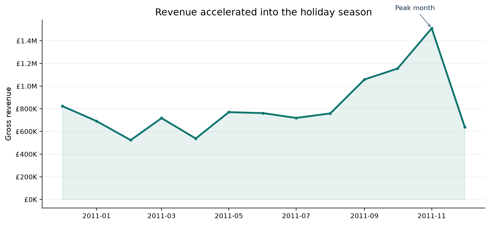
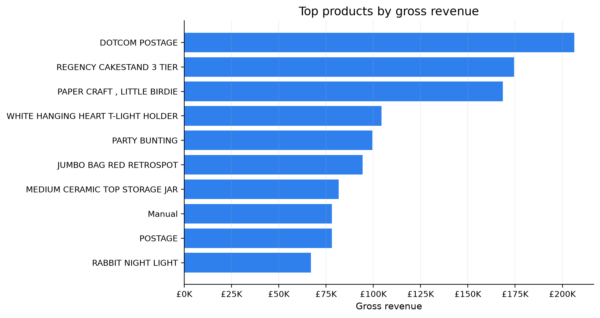
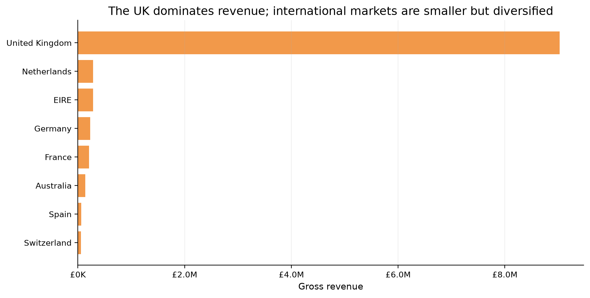
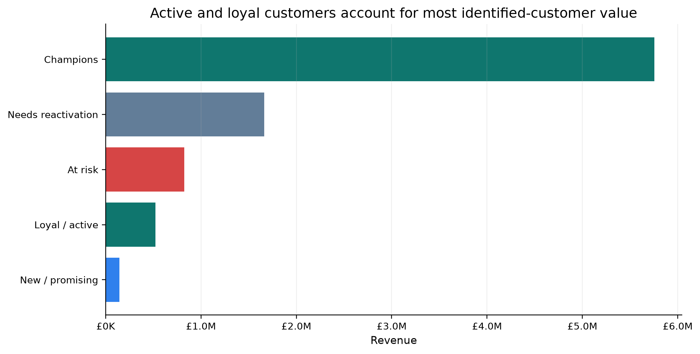
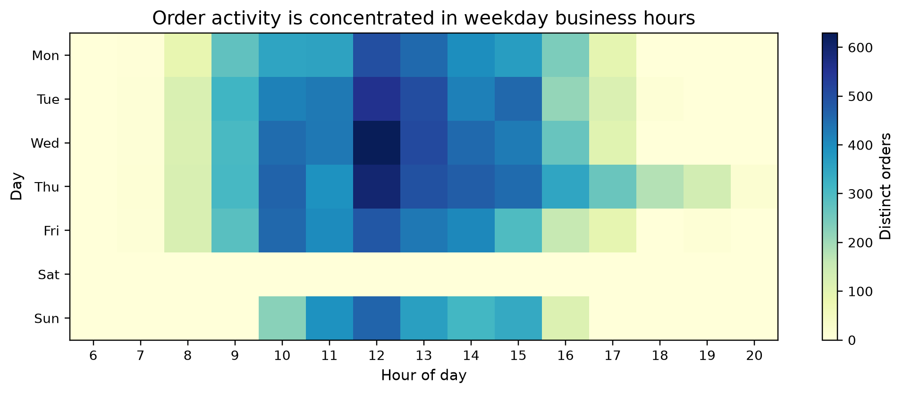

# Online Retail Growth & Customer Retention

## A portfolio case study in commercial analytics

**Data analyst portfolio | Python · pandas · SQL-ready logic · segmentation · data storytelling**  
**Dataset:** UCI Online Retail, a UK-based non-store retailer | **Analysis window:** 01 Dec 2010–09 Dec 2011

---

## The business question

How can a small online retailer use transaction data to protect revenue, prioritize customer retention, and plan around demand peaks?

This case study turns raw line-item transactions into a decision-ready view of **revenue performance, product concentration, market mix, order behavior, and customer value**. The analysis is designed to demonstrate the work expected from a data analyst: define business metrics, document cleaning choices, test patterns, and translate findings into actions.

## What the data says at a glance

- **£10.67M** gross revenue from valid, non-cancelled line items.
- **19,960** valid orders across **4,338** customers with an ID.
- **16.1%** cancellation rate by invoice count, a material operational signal.
- **November 2011** was the strongest month at **£1.51M**; February 2011 was the weakest at **£0.52M**.
- **84.6%** of revenue came from the United Kingdom, while 38 countries were represented.
- The RFM model identifies **947 Champions** generating **64.6%** of identified-customer revenue.

> **Portfolio takeaway:** The biggest commercial opportunity is not simply “sell more.” It is to protect the high-value customer base, reduce avoidable cancellations, and use the strong seasonal pattern to plan inventory and campaigns earlier.

## 1. Revenue performance and seasonality

Revenue built through the year and reached a clear peak in November 2011. The peak month generated about **2.9×** the revenue of February, the low point. That range is large enough to justify a seasonal operating plan rather than a flat monthly target.

### Recommended business action

Use a two-stage seasonal plan:

1. **Build inventory and campaign readiness before October.** November demand is visible in the history, so purchasing, fulfillment capacity, and promotional calendars should be ready before the peak.
2. **Use February as a reactivation window.** A lower-volume month is a useful time to test win-back offers, clean product data, and review the prior holiday cohort without competing with peak-season execution.

## 2. Product mix: revenue leaders need interpretation

The top-revenue list mixes physical products with a service-like line item: **DOTCOM POSTAGE** is the revenue leader at £206K across 706 orders. That is a useful data-quality and metric-design lesson. A commercial dashboard should separate postage or service charges from merchandise sales so category performance is not overstated.

The **REGENCY CAKESTAND 3 TIER** generated about £174K across 1,988 orders, while **PAPER CRAFT, LITTLE BIRDIE** generated about £168K in a single order. The latter is a strong example of why analysts should show both revenue and order count: a large line total can reflect wholesale behavior rather than repeat product demand.

### Recommended business action

Create three product views instead of one:

- **Merchandise revenue:** excludes postage and other service charges.
- **Repeatable demand:** ranks products by orders and customers, not revenue alone.
- **Wholesale / bulk exceptions:** flags products where revenue is concentrated in very few orders for account-management review.

## 3. Market mix and expansion priorities

The UK accounts for **84.6%** of gross revenue. International markets are smaller, but the data shows a diversified long tail: the Netherlands, EIRE, Germany, France, and Australia are the next largest markets in the extract.

This concentration is both a strength and a risk. The UK is the clear operating base, but a disruption in domestic demand would affect most revenue. International expansion should therefore be selective rather than broad: focus on markets with evidence of repeat orders, acceptable fulfillment economics, and enough customers to support localized activity.

### Recommended business action

Add three international KPIs to the recurring dashboard:

- revenue and orders by country,
- repeat-customer rate by country,
- cancellation or return behavior by country.

That combination distinguishes a market with one-off bulk orders from a market that can support durable growth.

## 4. Customer value: RFM segmentation

I built an RFM segmentation using:

- **Recency:** days since the customer’s last order,
- **Frequency:** number of distinct invoices,
- **Monetary:** total valid revenue.

Scores were assigned using quintiles. The segments are directional rather than predictive: they are intended to prioritize action, not label customers permanently.

| Segment | Customers | Revenue | Revenue share | Avg. recency | Avg. orders |
|---|---:|---:|---:|---:|---:|
| Champions | 947 | £5.76M | 64.6% | 13 days | 11.2 |
| Needs reactivation | 1,942 | £1.66M | 18.7% | 143 days | 2.0 |
| At risk | 661 | £0.83M | 9.3% | 151 days | 3.4 |
| Loyal / active | 478 | £0.52M | 5.9% | 16 days | 3.0 |
| New / promising | 310 | £0.14M | 1.6% | 18 days | 1.2 |

### Recommended retention playbook

- **Champions:** protect the relationship with early access, replenishment reminders, and high-touch service. This group drives most identified-customer value.
- **At risk:** prioritize targeted win-back tests. Their average frequency is meaningfully higher than the reactivation group, so the upside per saved customer may be stronger.
- **Needs reactivation:** use low-cost automated reminders and product recommendations before offering broad discounts.
- **New / promising:** focus on the second purchase. The first repeat order is the most important transition to measure.

The most important measurement improvement is to move from one-off campaign reporting to a **retention cohort view**: track whether customers who receive an intervention place another order within 30, 60, or 90 days.

## 5. Operating rhythm: when orders arrive

Order activity is concentrated in weekday business hours. This pattern can support practical staffing and service-level decisions, but it should be validated against the retailer’s actual fulfillment and support timestamps because invoice time is not the same as pick, pack, or dispatch time.

### Recommended business action

Use the observed order pattern to schedule labor and monitoring coverage, then connect it to operational data. The next dashboard iteration should add dispatch time, stock-outs, cancellation reasons, and delivery outcomes.

## Data preparation and analytical choices

The source contains 541,909 transaction rows and 8 fields. I treated invoice numbers beginning with **C** as cancellations, removed cancelled rows from gross-sales reporting, and excluded non-positive quantities or prices from the valid-sales base. Customer segmentation used only rows with a non-missing CustomerID.

These choices make the KPI definitions explicit:

- **Gross revenue:** sum of `Quantity × UnitPrice` on valid, non-cancelled rows.
- **Order:** distinct valid `InvoiceNo`.
- **Cancellation rate:** cancelled invoice count divided by valid plus cancelled invoice counts.
- **Customer revenue:** valid revenue linked to an identified CustomerID.

The cancellation rate is a monitoring signal, not a claim about confirmed refunds: the source does not provide a full reason code or settlement ledger. Likewise, the dataset’s time window ends on 09 Dec 2011, so the results are useful for portfolio analysis but should not be treated as a current market forecast.

## Reproducible workflow

1. Load the official Excel file with pandas.
2. Standardize dates and invoice identifiers.
3. Classify cancellations from the invoice prefix.
4. Calculate line revenue and filter invalid sales rows.
5. Aggregate revenue by month, product, country, and order.
6. Build customer-level RFM features and quintile segments.
7. Export tables and charts for review.
8. Translate the findings into measurable commercial actions.

The supporting analysis script and exported tables are included with this portfolio so the work can be audited or extended.

## Selected references

[1]: https://archive.ics.uci.edu/dataset/352/online+retail "UCI Machine Learning Repository: Online Retail"

[2]: https://doi.org/10.24432/C5BW33 "UCI dataset DOI: Online Retail"

[3]: https://www.semanticscholar.org/paper/e43a5a90fa33d419df42e485099f8f08badf2149 "Chen, Sain and Guo: Data mining for the online retail industry"

The dataset is credited to Daqing Chen and is licensed under CC BY 4.0. [1] [2] The UCI page also identifies the introductory RFM segmentation paper by Chen, Sain, and Guo. [3]

---

**Analyst profile signal:** This case study demonstrates metric definition, data cleaning, exploratory analysis, segmentation, visualization, business communication, and the judgment to separate operational charges and bulk-order anomalies from repeatable product demand.
